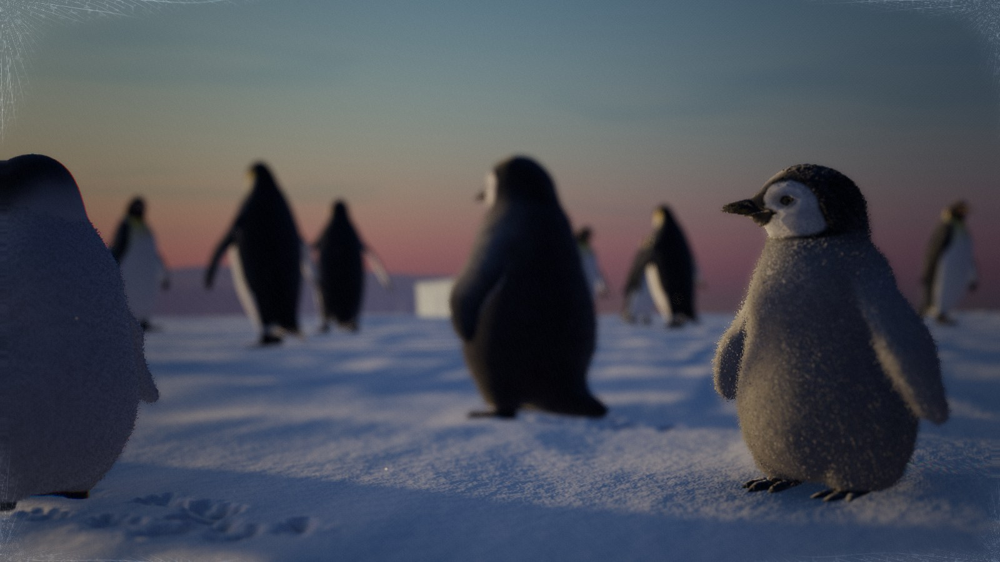
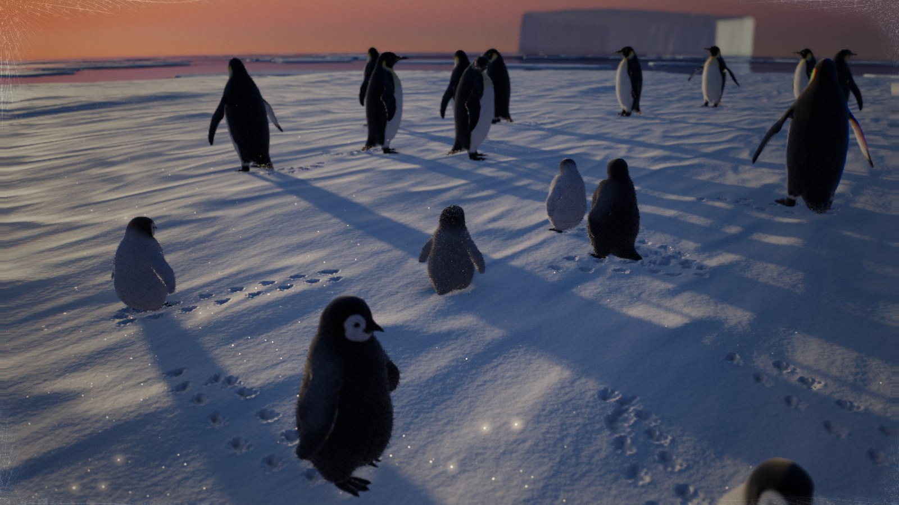
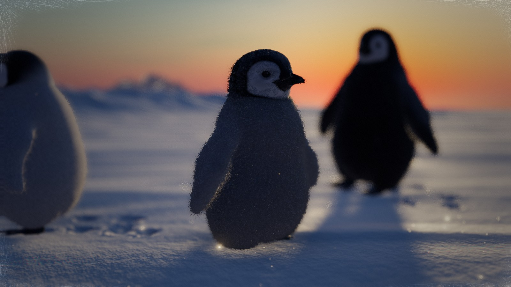
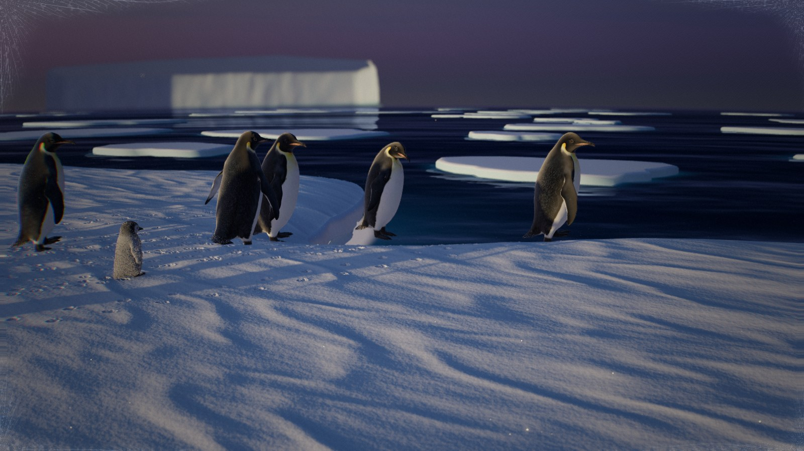
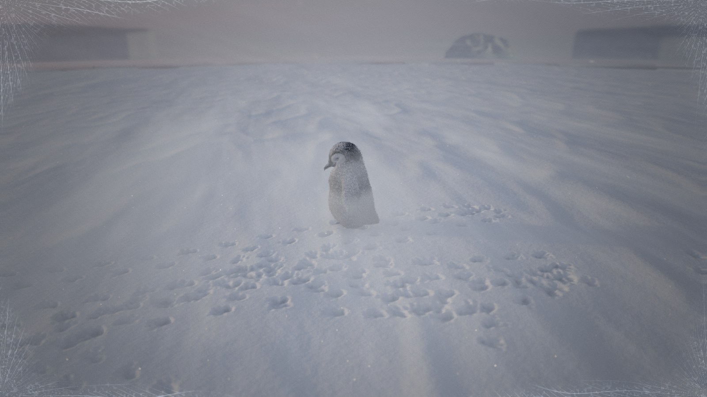
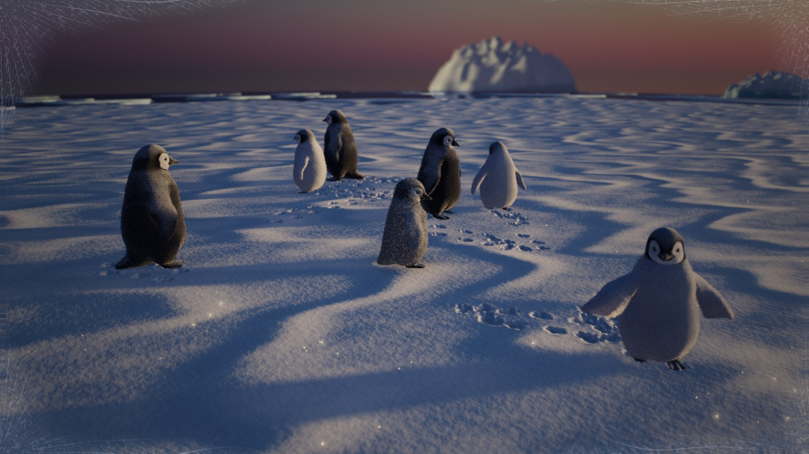

# Last light

*Dernière lumière*: a short, narrated browser game about an emperor penguin chick on the Antarctic sea ice, the last evening of summer, the evening its parents leave for the sea.



About ten minutes, five acts, no fail state. An old polar explorer remembers the chick he once watched and called Mumble; you are that chick. Find your parent among ten thousand voices, watch the adults walk to the sea, cross a floe that has suddenly become very large, sit out a ground blizzard in a huddle, and walk toward the water at first light.

Runs in any recent desktop browser with WebGL2. Best with headphones.

## Screenshots

| | |
|---|---|
|  |  |
| *The colony, before the departure* | *Photo mode: 50 mm, f/1.4* |
|  |  |
| *The adults leave for the sea* | *The ground blizzard* |
|  | |
| *First light* | |

All screenshots are taken in-engine from the release build.

## Features

- **A small story, told well.** Five acts, cinematics with a real camera language (rack focus, long lenses, handheld shake), and a warm English narrator with subtitles in English and French.
- **An orchestral score** that follows the story, with a mix that gives the music room in cinematics and gives the world back in play.
- **Sound you can place.** Calls, steps, splashes and the colony are heard from where they are (binaural in headphones); the wind blows from its real direction and the swell comes from the nearest coast.
- **A living colony.** Adults and chicks mill, huddle, answer calls, keep out of your way, and dive off the floe edge.
- **Snow that remembers.** Every step and belly slide leaves a print; the wind refills them; the storm erases them.
- **Photo mode.** Freeze the moment, fly the camera, pick a focal length, an aperture, focus, exposure, roll, a look, grain and vignette, then develop a full-resolution PNG.
- **Accessible by default.** Keys follow the physical layout (ZQSD on AZERTY, WASD on QWERTY) and can be rebound; mouse look with adjustable sensitivity and invertible axes; full controller support with Xbox and PlayStation button prompts; subtitles on by default; full screen; four quality presets with dynamic resolution.

## Controls

| Action | Keyboard | Controller (Xbox / PlayStation) |
|---|---|---|
| Walk / turn | W A S D or arrows (ZQSD on AZERTY) | Left stick |
| Hurry | Shift | RB / R1, RT / R2, or click the left stick |
| Belly slide | Space (hold to skip a cinematic) | A / ✕ (hold to skip) |
| Call | R | B / ○ |
| Interact | E (hold when asked) | X / □ |
| Show the objective | Tab | View / Share |
| Photo mode | F (Enter takes the photo) | Y / △ (A / ✕ takes the photo) |
| Hide the interface | H | D-pad up |
| Pause / options | Esc | Menu / Options |
| Camera | Mouse (captured in play), wheel to zoom | Right stick |

The controller works everywhere: on the title screen, in the pause menu, in the options (bumpers switch tabs) and in photo mode (the D-pad picks and sets the camera settings, the triggers raise and lower the camera). Prompts and hints show the buttons of the controller in hand, Xbox or PlayStation, and switch back to keys as soon as the keyboard or mouse is used. The controller vibrates with each step, a belly flop, a held interaction and the gusts of the storm (it can be turned off in **Options › Controls**).

Every key can be rebound in **Options › Controls**; the hints on screen always show your own keys. The same tab sets the look sensitivity and can invert the horizontal and vertical look axes (mouse and right stick).

## Run it

```bash
pnpm install
pnpm dev          # http://localhost:5178
```

Production build (a static site in `dist/`, served from any path):

```bash
pnpm build
pnpm preview      # http://localhost:4178
```

The characters ship compressed (Draco geometry and WebP textures: about 9 MB instead of 35 MB). The original exports live in `assets/models/`; after changing one, rebuild `public/models/` with `pnpm models`.

Every push to `main` builds the game and publishes it to GitHub Pages (`.github/workflows/pages.yml`). One-time setup in the repository: **Settings › Pages › Build and deployment › Source: GitHub Actions**.

URL options: `?quality=low|medium|high|ultra` sets the starting preset (it is also in **Options › Graphics** and remembered per browser). For development, `?debug` shows a tuning panel and a frame counter, and adds `&act=2..5` to jump to an act.

## How it is made

- **Three.js on WebGL2**, no engine. The map, snow, sky, weather, water and ice are procedural.
- **Characters** are Meshy models, auto-rigged and animated procedurally: a waddle with a moving pivot, belly slides with slope gravity, bows, dives, huddles. The hero chick is skinned on the GPU once per frame and wears shell-rendered down.
- **Snow** is a displaced height field with a footprint layer on a grid that moves in whole steps, so prints never swim; sun shadows and sky occlusion of the terrain are baked when the sun moves.
- **Post-processing**: the scene alone is rendered with MSAA, then light shafts, bloom that follows the sun, and one final pass for depth of field, lens flare, ACES tone mapping, chromatic aberration, frost, vignette and grain.
- **Audio** is Web Audio: a binaural soundscape heard from the camera, a mix bus for the score, and a voice bus that ducks the world under the narrator.
- **Score and narration** were generated with ElevenLabs (Music and Text to Speech) from the cue sheet in [`docs/music.md`](docs/music.md) and the script in [`docs/narration.md`](docs/narration.md).

```
src/
  main.js         renderer, camera, input, frame loop
  story.js        the five acts, cinematics, objectives
  colony.js       penguin AI, collisions, huddles, feeding
  penguin.js      rig, procedural gait, slides, skin fixes
  dive.js         the adults' dives
  environment.js  sky, sea, distant ice
  snow.js         snow surface and footprints
  weather.js      calm, breeze, storm, dawn
  groundblow.js   the blowing snow of the storm
  post.js         post-processing passes
  audio.js        soundscape, score, voice
  narration.js    narrator lines and subtitles
  hud.js          on-screen interface
  photo.js        photo mode
  options.js      options menu
  bindings.js     rebindable keys (physical layout)
  gamepad.js      controller input, button prompts, menu navigation
  i18n.js         English and French text
public/
  models/         characters (glTF, compressed)
  audio/          recordings, score, narration (see CREDITS.txt)
```

## Credits

- Character models: generated with Meshy.
- Score and narrator voice: generated with ElevenLabs.
- Penguin calls, footsteps, colony, wind and blizzard recordings: Creative Commons, listed in [`public/audio/CREDITS.txt`](public/audio/CREDITS.txt). The blizzard recording is by kevp888 (Kevin Luce), CC BY 4.0.
